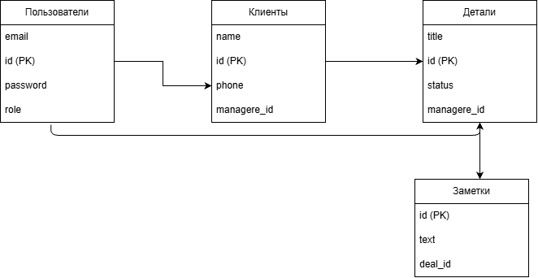

markdown
# Mini-CRM для учета клиентов и сделок
## Схема базы данных


## 📖 Описание проекта
Full-stack веб-приложение для управления клиентами и сделками. Включает в себя авторизацию (JWT), базу данных (SQLite), роли (Администратор/Менеджер) и удобный интерфейс для работы.

## 🛠️ Стек технологий
* **Backend:** Node.js, Express, SQLite3, JWT, Bcrypt.
* **Frontend:** HTML5, CSS3, Vanilla JavaScript (Fetch API).
* **Тестирование:** Jest, Supertest.

## 🚀 Инструкция по запуску (как проверить работу)

Для запуска проекта вам потребуется установленный **Node.js** (скачать можно с официального сайта nodejs.org).

Шаг 1. Скачайте проект и откройте терминал**
Откройте папку с проектом в VS Code и запустите встроенный терминал (Терминал -> Новый терминал).

Шаг 2. Установите зависимости**
В терминале выполните команду:
```bash
npm install

(Эта команда скачает все необходимые библиотеки, указанные в package.json)

Шаг 3. Запустите сервер
В том же терминале выполните:

bash
node server.js
Если вы увидели сообщение  Сервер запущен на http://localhost:3000 — значит, бэкенд работает.

Шаг 4. Создайте первого пользователя (Админа)
Так как регистрация происходит через API, откройте второй терминал (не закрывая первый) и выполните команду:

bash
curl -X POST http://localhost:3000/api/register -H "Content-Type: application/json" -d "{\"email\":\"admin@test.ru\",\"password\":\"123\",\"role\":\"admin\"}"
(Для Windows PowerShell используйте: Invoke-RestMethod -Uri "http://localhost:3000/api/register" -Method Post -Body '{"email":"admin@test.ru","password":"123","role":"admin"}' -ContentType "application/json")

Шаг 5. Откройте интерфейс
Откройте файл index.html в любом браузере (двойным кликом).
Введите данные для входа:

Email: admin@test.ru

Пароль: 123
